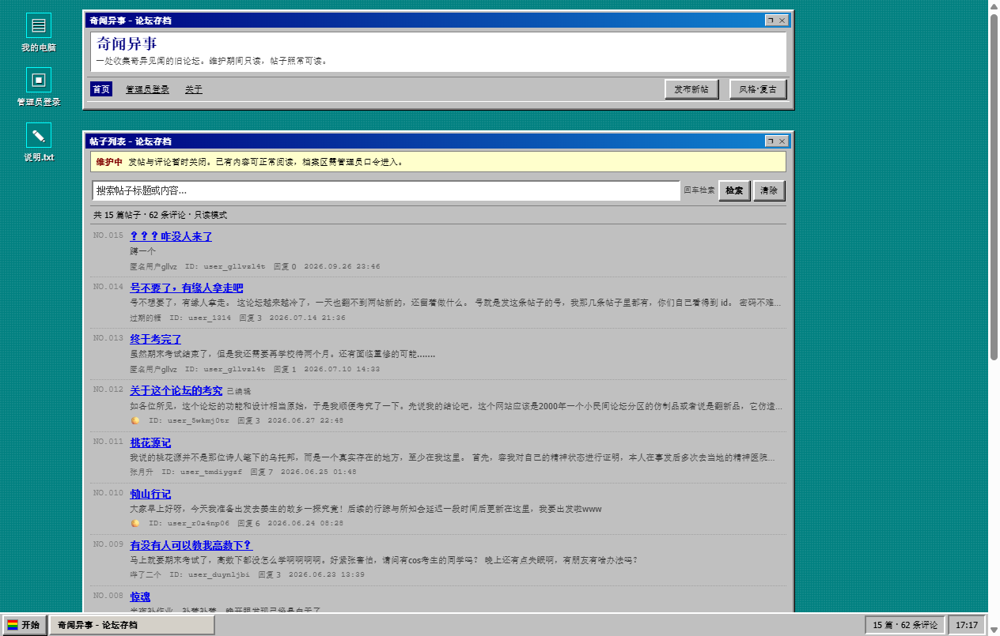
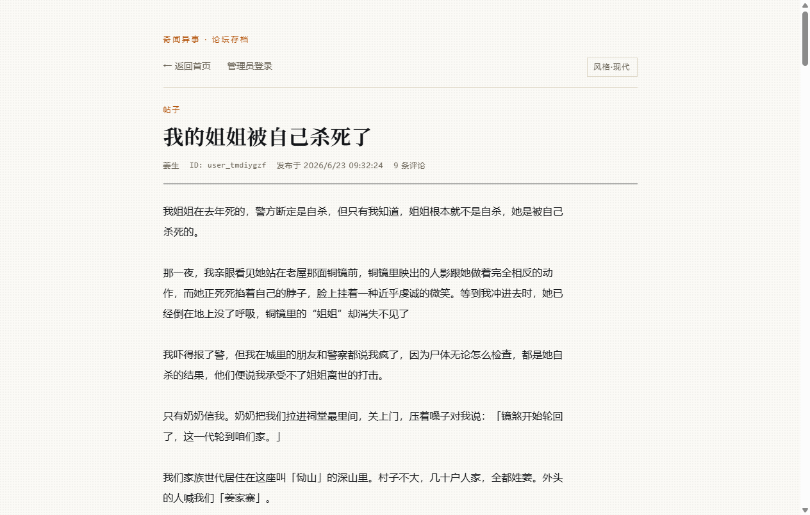
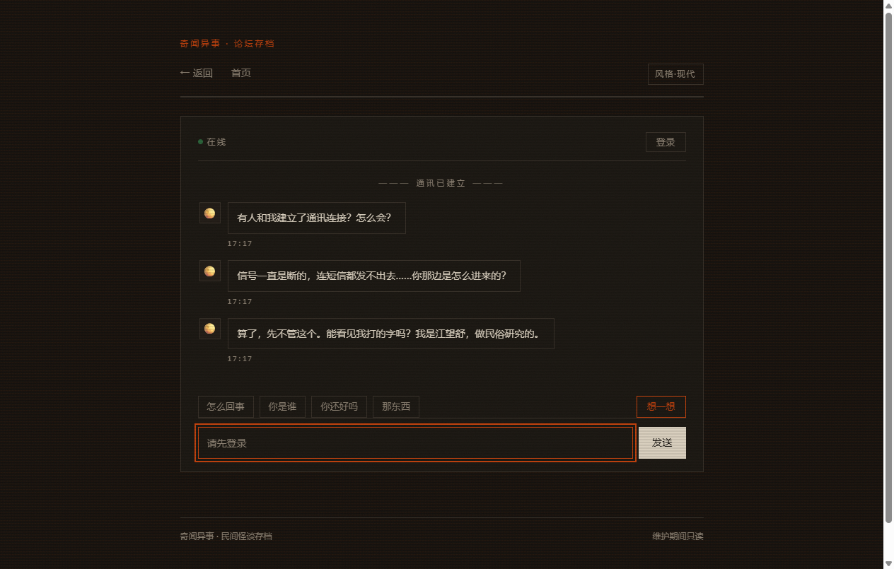

# 奇闻异事

> 一个旧论坛，一个人说她被困在井里，还有一些东西不太对劲。

**▶ 开始玩：<https://galizhajidanbaofan.github.io/>**


---

## 这是什么

一个做在浏览器里的短篇都市怪谈，形式是一整个假网站：一台桌面、一个 2000 年代的小民间论坛、几层不该被点开的页面。

你是访客。论坛里有人在发帖，也有人在回帖；有人在求救，有人只是在闲聊，而有些东西在第一遍读的时候看不出来。

- 单周目 20–40 分钟，可反复重玩，结局不止一个
- 桌面和手机都能玩，不需要注册、不需要下载
- 没有跳脸惊吓，没有音效，没有需要开声音的地方
- 项目进度**暂定完结**（V1），剧情线已写到结局

## 怎么开始

1. 打开 <https://galizhajidanbaofan.github.io/>，点桌面上的「异常档案」文件夹
2. 五卷档案里只有 `file 01 奇闻异事` 能打开，其余四卷会提示「已锁定」
3. 接下来就是一个论坛。读帖、点评论、用搜索框。
4. 论坛顶部写着「维护中」，发帖和评论按钮会弹一段说明——**这不是 bug**，是设定
5. 有些页面不会主动告诉你怎么进去；找不到路的时候，先想想这个站为什么长得这么旧

## 玩法提示（不剧透）

- **搜索框**是这个站最值得反复试的地方，它对某些词的反应不太一样
- 论坛有「管理员登录」，口令藏在帖子正文里，不用猜
- 列表里有些用户 ID 长得不太像 ID
- 右上角可以切「风格·现代 / 风格·复古」：同一份内容，两套皮（复古那套是 Windows 98）
- 进度存在你自己的浏览器里（`localStorage`），换设备、清缓存就没了
- 建议别先找攻略：这站一共没多大，剧透掉就没什么可玩的了

## 内容规模

| 项目 | 数量 |
| --- | --- |
| 公开帖子 / 评论 | 15 篇 / 62 条 |
| 随进度长出来的帖子 | 异常帖 6 篇 + 冒名帖 3 篇（最多 24 篇 / 69 条） |
| 隐藏页 | 3 层，一层比一层不对劲 |
| 结局 | 6 个（含 1 个坏结局） |
| 皮肤 | 现代（纸面档案）/ 复古（Windows 98） |

## 预览

**论坛 · 现代皮肤**——米白纸面，像一份整理过的档案。


**论坛 · 复古皮肤**——Windows 98 桌面，连任务栏都摆好了。



**帖子详情**——正文是这套东西的主体，排版照着旧站长文的读感做。



**聊天室**——越往里走，页面越不像一个正常网站。



**手机竖屏**——单列排版，编号栏让位给标题。


---

<details>
<summary><strong>⚠️ 剧透：六个结局与触发条件</strong>（想自己玩就别点）</summary>

| 编号 | 结局 | 怎么来的 |
| --- | --- | --- |
| END 01 | 失联 | 聊天室里连说三次违禁词，通讯被强制中断 |
| END 02 | 关站 | 读完管理员日志，选择关闭全站 |
| END 03 | 折中的对策 | 选择封停账号，两个号一起封 |
| END 04 | 识破 | 只封冒名的那个，保住真正求救的人 |
| END 05 | 棋差一着 | 封号封错了对象 |
| END 06 | 无辜的牺牲者 | 把唯一还在求救的人封掉 |

</details>

## 技术

- 纯静态站点，托管在 GitHub Pages，**没有后端、没有构建步骤、没有 npm 依赖**
- HTML + 原生 CSS + 原生 ES modules（`<script type="module">`）
- 所有内容都是 `data/*.json`，前端读取后渲染；玩家进度与剧情状态存在 `localStorage` / `sessionStorage`
- 两套皮肤共用一个 DOM，只换 CSS 变量与皮肤文件（复古的窗口标题栏靠 `data-window` 属性 → `::before{content:attr(...)}` 画出来）

### 本地跑起来

`js/` 用了 ES modules，双击 `index.html` 会被浏览器的 `file://` 策略拦下，需要起一个静态服务：

```bash
cd galizhajidanbaofan.github.io
python -m http.server 8000
# 打开 http://127.0.0.1:8000/
```

推送 `main` 分支即发布，不需要 Actions。

## 说明

- 站内人物、地名、机构、事件全部为虚构；论坛里的帖子与评论是本作的叙事文本，不是真实投稿。
- 管理员口令只是页面上的门，不是安全边界：静态站的隐藏内容（`data/archive.json`）随时可以被人直接下载。这里放的是叙事彩蛋，不是真秘密。
- 站点历史上有过一枚第三方数据服务的密钥随公开代码泄露，已经删除并在仓库里替换为占位符；如果那枚密钥还有效，请去后台吊销。
- 这个仓库只为讲故事，不做社区：发帖与评论在 2026 年 10 月起关闭，页面保留表单，点击只弹维护说明。

---

<details>
<summary><strong>🛠 维护者笔记</strong>（目录、线索表、状态键，含剧透）</summary>

### 目录

```
.
├── index.html            起点：异常事件档案馆（Win11 式桌面 → file 01 进论坛）
├── forum.html            论坛首页：帖子列表、搜索、发帖入口（维护提示）
├── post.html             帖子详情 + 评论区（只读）
├── admin.html            管理员模式 / 档案区
├── secret.html           隐藏页 一档「轻」：点文件夹 → 口令
├── archive.html          聊天室 二档「中」
├── dossier.html          档案条目 #7742 三档「重」
├── office.html           民俗研究室（聊天关键词「工作」进入）
├── map.html              恸山局部图（手绘等高线 SVG，「恸山」进入）
├── ending-lost.html      坏结局 01「失联」
├── ending.html           结局页（?e=shutdown|compromise|insight|outplayed|innocent）
├── log.html              管理员日志（只读）
├── duel.html             站务决策页（关站 / 封号）
├── 404.html
├── ui.css                结构层 + 组件（布局、列表行、详情、弹窗、任务栏）
├── style-modern.css      皮肤：现代（米白纸面）
├── style-retro.css       皮肤：复古（Win98 窗口 + 任务栏）
├── hidden.css            隐藏页三档配色 + 扫描线 / 噪点
├── library.css           旧入口「图书馆」皮肤（仅预览稿引用）
├── js/
│   ├── main.js           入口：定主题 + 按 body[data-page] 装载
│   ├── config.js         站点配置、维护文案、管理员凭据、可疑 ID 表
│   ├── store.js          读 data/*.json 并合并剧情帖（loadStoryPosts）
│   ├── render.js         列表 / 详情 / 评论渲染；uidHtml() 管可疑 ID 的可点门槛
│   ├── state.js          玩家进度（localStorage: qiwenyishi_progress）
│   ├── hidden.js         隐藏页：冻结时钟、口令、聊天与三类线索
│   ├── account.js        账号门（卖号帖 → 账号 / 密码 → 聊天室）
│   ├── endings.js / ending.js / log.js / duel.js   结局、日志、站务决策
│   ├── lore.js / search.js / format.js / ui.js / theme.js / auth.js
│   └── pages/            home.js / post.js / admin.js
├── data/
│   ├── posts.json        公开帖 15 篇 / 62 条评论
│   ├── posts-glitch.json 异常帖 6 篇（按 tier 逐步出现）
│   ├── posts-late.json   冒名帖 3 篇（进入 impostor 后出现）
│   └── archive.json      隐藏档案（目前为空）
├── docs/preview/         README 用的截图
├── tools/
│   ├── password-hash.html  生成 PBKDF2 口令凭据
│   └── strip-hud.py        截图去除截图工具悬浮条的辅助脚本
├── _archive/             停用的旧文件（原 script.js / style.css）
└── _data-backup/         迁移前的 JSONBin 原始快照
```

### 聊天室的三类线索

`archive.html` 的输入框是所有分支的入口，命中顺序 **违禁词 → 异常 → 背景补充**。

| 类 | 触发词（举例） | 结果 |
| --- | --- | --- |
| 背景补充 | `工作`、`恸山`、`姜家寨`、`井`、`那东西` | 讲一段设定；`工作` 给 `office.html`，`恸山` 给 `map.html` |
| 异常 | `广告`/`AAA`/`道士`、`编号`、`口口`/`打码`、`ID`/`账号`、`署名`/`🌕` | 井壁多一道刻痕，论坛多出 1–2 篇异常帖；集齐三条后冒名者入场 |
| 违禁词 | `拟物`、`仿造`、`收容`、`仿制品` | 涂黑 + 「已自动屏蔽违禁词」；第三次触发 `ending-lost.html` |

状态存在 `sessionStorage.chat_state`（`{ redact, anomalies, impostor }`）。触发词全在 `js/hidden.js` 顶部的 `CHAT` 常量里，改线索不用动逻辑。

### 可疑 ID 的门槛

论坛里 `CONFIG.clues.suspectUids` 里的 ID 是可点的，但必须先①进过聊天室、②问过一句 `怎么回事`。两个印记存在 `qiwenyishi_progress.flags`（`chat.entered` / `chat.briefed`）。没满足时 `render.js` 的 `uidHtml()` 直接渲染成普通 `<span>`，`main.js` 里还有一道同样的判断兜底。

### 帖子的层叠

`store.js` 的 `loadStoryPosts()` 把 `posts.json` 与 `posts-glitch.json`、`posts-late.json` 合并：前者按 `tier` 逐步出现（时间被写坏的那篇会显示「时间未知」并排到最后），后者在聊天室进入 impostor 后出现。所以「帖子数从 15 变 17、变 24」是设计好的。

### 添加内容

- **公开帖**：往 `data/posts.json` 的 `posts` 里加一条，`id` 用字符串毫秒时间戳，时间写带时区的 ISO 8601（`+08:00`），`editTime` 有值就显示「(已编辑)」。
- **隐藏档案**：同样的结构写进 `data/archive.json`，只能通过 `post.html?id=…&from=archive` 且先进管理员模式打开。
- **管理员口令**：本地打开 `tools/password-hash.html` 生成凭据，粘进 `js/config.js` 的 `admin.credentials`（支持 `pbkdf2` 与旧 `sha256` 并存）。
- **维护开关**：文案在 `js/config.js` 的 `maintenance`；真要开放发帖得接后端，纯静态做不到。

### 已知取舍

- 管理员模式不是安全边界，`data/archive.json` 是公开文件。
- 原 `script.js` 里曾明文写着 JSONBin Master Key，已删除并替换为占位符；若仍有效请吊销。
- 老帖子里的 `■□` 是原样文本，还没有做成可交互的打码效果；`js/lore.js` 的彩蛋词表也没和它联动。

</details>
